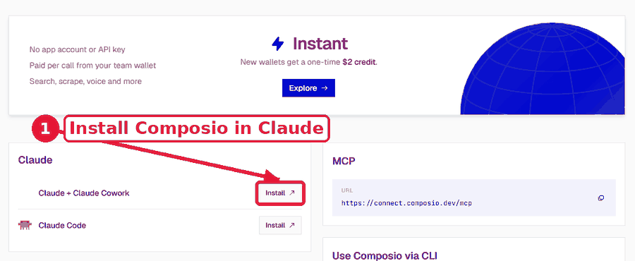
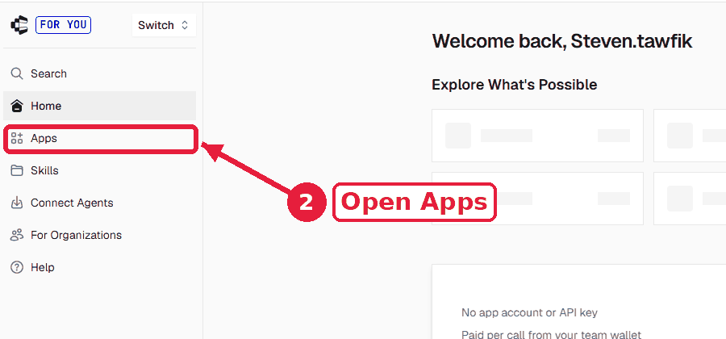
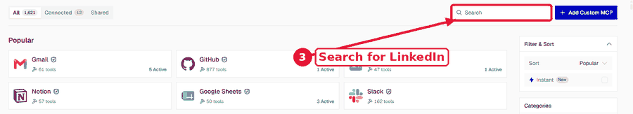
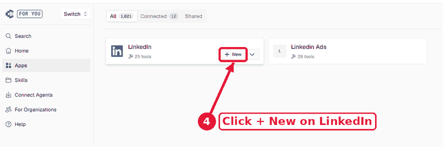
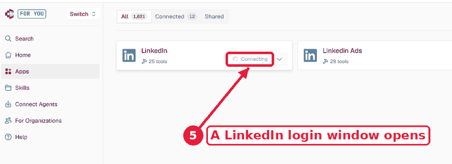
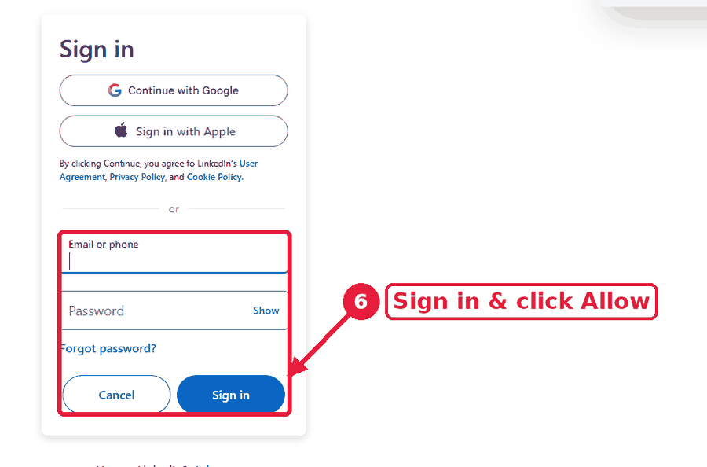

# 💼 خلّي Claude يمسك الـ LinkedIn بتاعك (عن طريق Composio)

كلنا عارفين إن العملاء والـ Recruiters موجودين على LinkedIn... وكلنا برضه سايبينه ميت، عشان مفيش وقت نكتب ونعلّق ونظبط البروفايل.
الحل: تربط Claude بـ LinkedIn مرة واحدة، وهو يكتبلك البوستات والكومنتات ويظبطلك البروفايل، وانت بس تقول "انشر".

هنا هتلاقي **البرومبتات التلاتة اللي بستخدمها بالظبط**، وكل واحد معاه شرح بيعمل إيه وامتى تستخدمه.

> 💡 انسخ الـ Prompt زي ما هو، وغيّر بس الحاجات اللي بين `[ ]`.

---

## 🔌 الأول: اربط Claude بـ LinkedIn عن طريق Composio

ادخل على [dashboard.composio.dev](https://dashboard.composio.dev) واعمل حساب (أو Login لو عندك حساب). وبعدين امشي ورا الخطوات دي:

### 1️⃣ اربط Composio بـ Claude
من الصفحة الرئيسية، في مربع **Claude**، دوس **Install** اللي جنب **Claude + Claude Cowork**، وكمّل الخطوات لحد ما Composio يظهر في الـ Connectors بتوع Claude.



> 💡 لو عايز تضيفه بإيدك: هتلاقي لينك الـ MCP في نفس الصفحة (`https://connect.composio.dev/mcp`)، ضيفه كـ Custom Connector في Claude.

### 2️⃣ افتح Apps
من القايمة اللي على الشمال، دوس **Apps**.



### 3️⃣ دوّر على LinkedIn
اكتب `linkedin` في خانة **Search** اللي فوق على اليمين.



### 4️⃣ دوس + New على LinkedIn
هيظهرلك كارتين، اختار **LinkedIn** (مش LinkedIn Ads) ودوس **+ New**.



### 5️⃣ استنى نافذة LinkedIn
الزرار هيقول **Connecting**، وهتفتحلك نافذة جديدة فيها صفحة تسجيل الدخول بتاعة LinkedIn.



### 6️⃣ اعمل Sign in ووافق
اكتب الإيميل والباسورد (أو ادخل بـ Google أو Apple)، ودوس **Sign in**، وبعدين دوس **Allow** عشان توافق على الصلاحيات. بعدها LinkedIn هيظهر عندك في **Connected** على Composio.



### ✅ خلاص 🎉
ارجع لـ Claude وجرّب تقوله: `what's my LinkedIn profile name?`. لو رد صح يبقى كله شغال، ومن هنا Claude يقدر يكتب وينشر ويعلّق باسمك، بعد ما يعرض عليك الأول.

📚 لو محتاج تفاصيل أكتر عن الـ Connectors: [support.claude.com](https://support.claude.com) — وعن Composio: [composio.dev](https://composio.dev)

---

## ✍️ 1. حوّل أي محتوى عندك لبوست LinkedIn وانشره

استخدمه لما يكون عندك ريل، فيديو، أو فكرة نجحت في مكان تاني وعايز تعيد استخدامها على LinkedIn.

```
Here is content I already made: [الصق سكريبت الريل / الفيديو / الفكرة هنا]

Turn it into a LinkedIn post written in a founder's voice:
- A first line that stops the scroll (strong, but no clickbait)
- Short lines and lots of white space, easy to read on mobile
- One clear lesson or result, with a concrete number or example if I gave one
- End with a question that invites people to comment
- 3-5 relevant hashtags at the end
- Under 1,300 characters

Show me the final post first and wait for my approval.
Only after I say "publish", post it on LinkedIn from my personal profile [وكمان من صفحة الشركة: اسم الصفحة].
Do NOT publish anything without my explicit approval.
```

**بيعمل إيه؟** بياخد محتوى عملته قبل كده ويعيد كتابته بأسلوب LinkedIn، يوريهولك، ولما توافق ينشره باسمك (وعلى صفحة شركتك لو عايز).

**نصيحة:** عشان ينشر على صفحة الشركة، لازم تكون **Admin** على الصفحة دي. ولو البوست طلع رسمي زيادة، قوله: `make it sound more like me talking, less corporate`.

---

## 💬 2. كومنتات بتضيف قيمة (مش Great post!)

استخدمه كل يوم على بوستات ناس في مجالك، عشان اسمك يظهر قدام ناس جديدة.

```
Here is a LinkedIn post: [الصق لينك البوست أو نص البوست]

Write 3 comment options I could leave on it as [انت مين، مثلاً: founder of an AI automation agency]:
- Each one adds real value: a practical tip, a short personal experience, or a smart follow-up question
- 2-4 sentences, natural and human, not salesy
- No "Great post!", no generic praise, no emoji spam, and don't pitch my services
- Each option takes a different angle

Wait for me to pick one. Only then post the one I choose as a comment under that post.
Do NOT post anything without my approval.
```

**بيعمل إيه؟** بيقرا البوست ويكتبلك 3 كومنتات مختلفة كلها فيها قيمة حقيقية، تختار واحد وهو ينزله باسمك.

**نصيحة:** لو Claude مقدرش يوصل للبوست من اللينك، الصقله نص البوست نفسه وخد الكومنت انزله بإيدك. وخليك على كام كومنت مفيد في اليوم، مش 50 كومنت ورا بعض.

---

## 🧑‍💼 3. ظبّط الـ Headline والـ About عشان يجيبوا عملاء

استخدمه مرة واحدة دلوقتي، وبعدين كل ما شغلك أو هدفك يتغيّر.

```
Here is my current LinkedIn profile:
Headline: [الـ Headline الحالي]
About: [الـ About الحالي]
What I do: [بتشتغل إيه وبتساعد مين]
Who I want to attract: [عملاء / Recruiters / شركاء]

Rewrite my profile to attract these people:
1. Give me 3 headline options (max 220 characters each): who I help + the result I get them + proof if possible
2. Write a new About section (max 2,600 characters): a strong first 2 lines, what I do, results or proof, who it's for, and a clear call to action at the end
3. Show everything as Before -> After so I can compare
Write it in [English / Arabic].
```

**بيعمل إيه؟** بيحوّل البروفايل من "سيرة ذاتية" لصفحة بتقول للعميل بالظبط انت بتعمله إيه وليه يكلمك.

**مهم:** LinkedIn مش بيسمح لأي أداة خارجية تعدّل البروفايل نفسه. فـ Claude بيكتبلك النسخة الجديدة، وانت بتنسخها وتلصقها في البروفايل في دقيقة.

---

## 🇪🇬 تقدر تكتبله بالمصري كمان

```
خد السكريبت ده [الصق السكريبت] وحوّله بوست LinkedIn بنبرة founder.
أول سطر يشد، سطور قصيرة، وفي الآخر سؤال للناس.
ورّيهولي الأول، ومتنشرش غير لما أقولك "انشر".
```

---

## ⚠️ نصايح مهمة

- **خلّيه يعرض عليك الأول دايماً.** متديش Claude إذن ينشر أو يعلّق من غير موافقتك.
- **حط لمستك.** عدّل كلمة أو اتنين في كل بوست وكومنت عشان يبان إنه انت.
- **متكترش.** نشاط كتير جداً ورا بعض بيبان آلي، وLinkedIn بيلاحظ ده.
- **صفحة الشركة محتاجة Admin.** من غير صلاحية Admin، Claude هينشر على بروفايلك الشخصي بس.
- **لو هتصوّر شاشتك**، اعمل Blur لأسماء الناس والكومنتات اللي مش بتاعتك.

---

## 🚀 الخلاصة

| قبل | بعد |
|---|---|
| LinkedIn ميت عشان مفيش وقت | بوست جاهز من محتوى عندك أصلاً في دقيقة |
| بتعدّي على البوستات من غير ما تعلّق | كومنت مفيد باسمك كل يوم |
| بروفايل مش بيقول انت بتعمل إيه | Headline وAbout مكتوبين عشان يجيبوا عملاء |
| بتقعد تكتب كل حاجة بنفسك | Claude يكتب وانت بس تقول "انشر" |

---

لو استفدت، تابعني عشان فيه Prompts وأتمتة أكتر جاية 🔥

**Steven Ayman — Vida AI**
